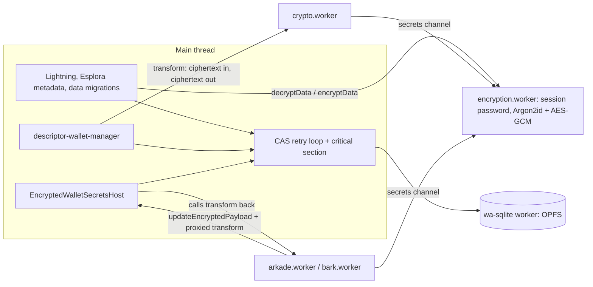
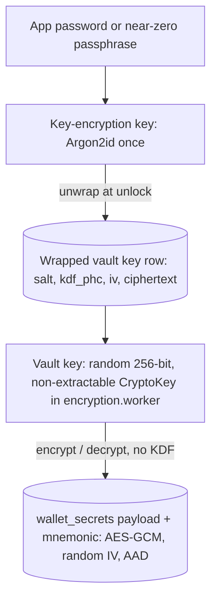

# Wallet secrets persistence: simplification options

Planning note. Nothing here is implemented. It was written after the PR #71 security review, whose fixes S-01 (password change lost concurrent writes) and S-02 (one hung write blocked every later write and the lock) both came from the design described under [Problem](#problem). The four options below can be adopted one at a time. They are ordered by how much complexity each removes per unit of work.

Related:

- Persistence overview: [docs/persistence/overview.md](../persistence/overview.md), [docs/persistence/general.md](../persistence/general.md)
- Rail payload layouts: [bitcoin-onchain.md](../persistence/bitcoin-onchain.md), [lightning.md](../persistence/lightning.md), [arkade.md](../persistence/arkade.md), [bark.md](../persistence/bark.md)
- Write API: `frontend/src/db/wallet-persistence.ts` (`updateWalletSecretsPayloadWithRetry`, `updateWalletSecretsEncryptedPayloadWithRetry`, `reencryptAllWalletSecretsWithNewPassword`)
- Worker write bridge: `frontend/src/lib/wallet/encrypted-wallet-secrets-host.ts`, `frontend/src/workers/encrypted-secrets-host-channel.ts`, `frontend/src/workers/worker-wallet-payload-update.ts`
- Locks and queues: `frontend/src/lib/shared/opfs-writer-lock.ts`, `frontend/src/lib/shared/serial-task-queue.ts`, `frontend/src/db/wallet-secrets-write-tracker.ts`
- Encryption: `frontend/src/workers/encryption.worker.ts`, `frontend/src/workers/encryption-secrets-session.ts`, `bitboard-encryption/src/lib.rs`
- Near-zero mode: `frontend/src/db/near-zero-security.ts`
- Feature contracts: LIFE-SECRETS-01 to 03 in [doc/features/wallet-lifecycle.yaml](../../doc/features/wallet-lifecycle.yaml)
- Review that triggered this note: `.cursor/pr-reviews/pr-71-phase-2-security.md`

---

## Problem

### One blob, many writers

Each wallet has one `wallet_secrets` row. Apart from the mnemonic, which has its own columns, everything sensitive lives in one encrypted JSON document, `WalletSecretsPayload`:

| Field | Written by | Typical size |
|-------|------------|--------------|
| `descriptorWallets[].changeSet` and sync metadata | crypto worker (after sync, send, receive reveal), main thread (Esplora sync timestamps) | tens of KB to MB |
| `lightningNwcConnections[]` and `nwcSnapshot` | main thread (`lightning-wallet-secrets.ts`, `lightning-wallet-snapshot-persistence.ts`) | small to hundreds of KB |
| `arkadeAccounts[].sdkPersistenceJson`, `activeArkadeAccountIdByNetwork` | Arkade worker (`arkade-worker-encrypted-payload.ts`) | up to 10 MiB (`ARKADE_SDK_PERSISTENCE_JSON_MAX_BYTES`) |
| `barkAccounts[].recordEnvelope`, `pendingEmergencyClaim`, `proceedAutomatically`, sync metadata | Bark worker (`bark-worker-metadata.ts`) | up to 10 MiB per network (`BARK_RECORD_ENVELOPE_MAX_BYTES`) |
| Any field | wallet data migrations (`run-pending-wallet-data-migrations.ts`) | whole payload |

Every change, even flipping `proceedAutomatically`, reads the row, decrypts the whole payload, applies the change, encrypts the whole payload and writes it back with a revision check. Independent subsystems therefore conflict with each other all the time, although they never touch the same fields.

### Every encrypt and decrypt runs Argon2id

`doEncrypt` and `doDecrypt` in `encryption.worker.ts` derive a fresh key from the session password, using the per-blob salt and `kdf_phc` (production: `$argon2id$v=19$m=65536,t=3,p=4`). One payload update costs two full key derivations, which takes seconds. Each read-modify-write window is therefore long, and the coordination below exists to survive it.

The same choice ties the data to the password itself. Changing the password, or leaving near-zero mode, has to decrypt and re-encrypt every wallet. That is the window in which S-01 lost writes.

### Three write paths that cross threads



1. **Main-thread writers** (`updateWalletSecretsPayloadWithRetry`): Lightning, Esplora sync metadata, data migrations. `decryptData` returns the **whole payload plaintext to the main thread**, including NWC URIs, Arkade SDK JSON and Bark envelopes. The statement in the persistence overview that plaintext never crosses the main thread is true for the rail-worker paths, not for these.
2. **On-chain** (`updateDescriptorWalletChangeset`): the main thread runs the CAS loop, and the transform asks the crypto worker to turn old ciphertext into new ciphertext. The crypto worker decrypts and encrypts through the secrets channel.
3. **Arkade and Bark** (`updateDecryptedWalletPayload`): the worker calls the main-thread host through Comlink and passes a proxied transform. The host runs the CAS loop and calls the transform back in the worker, which decrypts and encrypts through the secrets channel. One write therefore crosses worker → main → worker → encryption worker → worker → main → SQLite worker. If the worker is terminated or stuck during that time, the critical section is held by a promise that never settles.

### The writer lock cannot be re-entrant per call chain

JavaScript has no async context, so `createOpfsWriterLock` counts `holdDepth` for the whole tab. While any writer holds the lock, every other writer in the same tab runs straight through. That forced a second same-tab serial queue (`runWalletSecretsCriticalSection`) on top, and the rule "work inside must never wait for another wallet-secrets write, or it deadlocks".

### Coordination layers in place today

All of these exist to protect one read-modify-write of one blob:

1. Cross-tab Web Lock `bitboard-wallet-writer` (`opfs-writer-lock.ts`)
2. The lock's own same-tab FIFO chain (`sameTabWriteChain`)
3. Same-tab critical-section queue (`createSerialTaskQueue` in `wallet-persistence.ts`)
4. CAS on `wallet_secrets.revision` with up to 8 retries (`WALLET_SECRETS_CAS_MAX_RETRIES`)
5. Flush tracking with a deadline (`wallet-secrets-write-tracker.ts`, LIFE-SECRETS-02)
6. Detach signal for terminated rail workers (`encrypted-secrets-host-channel.ts`)
7. Transform time budget (`DEFAULT_TRANSFORM_TIMEOUT_MS`, LIFE-SECRETS-03)
8. In-flight counter in the encryption session, plus `endWalletSecretsSessionReliably` retrying while operations finish
9. `afterReencrypt` inside the critical section for password changes (LIFE-SECRETS-01)

Each layer is reasonable on its own. Together they are hard to reason about, and each new writer has to know about all of them.

---

## Goals

- A payload write is short (milliseconds), so concurrency windows are small.
- Changing the password does not touch wallet data.
- A write is a value that is fully received before it starts. Nothing in the critical section waits for a callback into another worker.
- Subsystems that do not share fields do not conflict.
- Plaintext payload data stays out of the main thread.
- Fewer layers, each with one clear job.

## Non-goals

- Changing what is encrypted. Everything sensitive stays encrypted at rest.
- Leaving SQLite over OPFS or adding another storage backend.
- Changing the Kysely schema migrations, the wallet data migration framework or its privacy rule (every wallet gets every marker and is re-encrypted). These work and stay.
- The Lab database. It is unencrypted and has its own lock.

---

## Option A: Envelope encryption with a vault key

This option removes the most complexity for the least work, and it is independent of B to D.

### Design



- **Vault key.** When the first app password (or the near-zero session) is created, generate 32 random bytes. That is the key that actually encrypts wallet data.
- **Wrapping.** Derive a key-encryption key (KEK) from the password with Argon2id, using the existing `bitboard-encryption` derivation and PHC parameters. Encrypt the vault key with the KEK (AES-GCM, or AES-KW via WebCrypto `wrapKey`). Store salt, `kdf_phc`, IV and the wrapped key in one row. It must live in the wallet SQLite file, either as a `settings` key or a small dedicated table, so the signed backup ZIP stays self-contained.
- **Session.** At unlock, run Argon2id once, unwrap, and import the vault key as a **non-extractable** WebCrypto `CryptoKey`. The encryption worker keeps that key instead of the password. Locking drops the key.
- **Blob format.** AES-256-GCM with the vault key and a random 96-bit IV. No per-blob salt and no KDF. Bind each ciphertext to where it belongs through additional authenticated data, for example `bitboard/wallet_secrets/v1/payload/<wallet_id>` and `.../mnemonic/<wallet_id>`. A swapped or copied ciphertext then fails to decrypt, which is a hardening the current format lacks. The existing `kdf_phc` columns can carry a format marker such as `vault-v1`, so readers can tell the formats apart during migration.
- **Optional subkeys.** Derive per-wallet or per-purpose keys from the vault key with HKDF. This is cheap and keeps the mnemonic key separate from the payload key, but it is not required for correctness.

### What changes

| Flow | Today | With a vault key |
|------|-------|------------------|
| Unlock | Session password stored; each later operation runs Argon2id | One Argon2id to unwrap; later operations are plain AES-GCM |
| Payload write | 2 × Argon2id + AES-GCM | AES-GCM only, typically milliseconds |
| Change password | Decrypt and re-encrypt every wallet under the critical section, then switch the session | Verify the old password by unwrapping, re-wrap with the new one, write one row. Wallet data is untouched; the session key stays the same |
| Near-zero mode | Random session secret wrapped with the public passphrase; wallets encrypted under that secret | Vault key wrapped with the public passphrase. Same code path as a real password |
| Near-zero upgrade | Re-encrypt every wallet under the user password | Re-wrap the vault key under the user password |
| Mnemonic reveal or export password prompt | Decrypt with the entered password | Unwrap with the entered password |
| Backup / import | Signed ZIP of the SQLite file | Unchanged; the wrapped key is inside the file |

### What can be removed or simplified afterwards

- `reencryptAllWalletSecretsWithNewPassword`, its critical section and `afterReencrypt`. LIFE-SECRETS-01 becomes "changing the password re-wraps the vault key; concurrent payload writes keep working". The near-zero upgrade branch that re-encrypts wallets goes away too.
- The S-02 time budget and flush deadline stay as safety nets, but a legitimate write now takes milliseconds, so they never come close to firing.
- `withSessionPassword` becomes `withVaultKey`. Every operation gets a reference to the same `CryptoKey`, so ending the session no longer has to wait for in-flight operations, and the in-flight counter plus `endWalletSecretsSessionReliably` can probably be simplified.
- `encryptDataWithPassword` and `decryptDataWithPassword` remain only for wrapping and unwrapping.

### Migration

1. Add the wrapped-key row (schema or settings), plus the format marker.
2. On the first unlock after the upgrade, inside `runUnlockLoad` before any rail loads (where wallet data migrations already run): decrypt every wallet with the password as today, create and wrap the vault key, re-encrypt every payload and mnemonic under it, and commit everything plus the key row in **one transaction**. A mixed state, with some wallets in the old format and some in the new, must not be possible.
3. In near-zero mode, do the same with the unwrapped near-zero secret, then replace `near_zero_wrapped_session_secret` with the wrapped vault key.
4. Readers accept the old format only inside that migration. After it, an old-format blob is an error.

### Security review points

- **Offline guessing cost is unchanged.** An attacker with the SQLite file still has to run Argon2id per password guess, now against the wrapped key instead of any blob.
- **A password change does not re-key the data.** Someone holding an old backup and the old password can unwrap the old copy of the vault key, which also decrypts newer ciphertext. Today a password change re-encrypts everything, so this is a real difference. For a wallet it matters little, because the mnemonic, the most valuable secret, never changes anyway. Options: accept and document it, or offer an explicit "rotate encryption key" action that does today's full re-encrypt as a rare, user-started operation.
- **Memory exposure gets better.** Today the encryption worker holds the password, which the user may reuse elsewhere. With this option it holds a non-extractable key that is useless outside this app.
- **IV limits.** With random 96-bit IVs, one key should stay below about 2³² encryptions. Even with frequent rail writes this is many orders of magnitude away. Note it in the spec.
- **Needs an explicit security review and approval.** It changes the encryption design, which the coding codex lists as needing human permission.

### Spec and test impact

- New contracts in `wallet-lifecycle.yaml`: unwrap at unlock, re-wrap on password change, near-zero wrap, AAD binding (a moved ciphertext fails), migration is all-or-nothing.
- The mock encryption worker (`frontend/src/db/__tests__/mock-encryption-worker.ts`) must model the vault key, or tests stop proving anything about the real flow.
- Argon2id can stay in `bitboard-encryption`, and AES-GCM is WebCrypto in TypeScript, so a Rust change may not be needed. If one is made, the WASM rebuild rule applies.
- Update `docs/persistence/general.md` (encryption table) and `overview.md`.

---

## Option B: Declarative payload commands with a single writer

This option removes the callbacks that cross threads and the plaintext on the main thread. Its value grows a lot when combined with A.

### Design

Transforms already have to be pure merges (see the comment on `updateDecryptedWalletPayload`). Express them as **data** instead of functions:

```typescript
type WalletPayloadCommand =
  | { kind: 'setDescriptorWalletChangeset'; descriptor: DescriptorWalletKey; changesetJson: string; markFullScanDone?: boolean }
  | { kind: 'setBarkRecordEnvelope'; network: BarkRailNetwork; recordEnvelope: string; metadata: BarkRailFlushMetadata }
  | { kind: 'setBarkPendingEmergencyClaim'; network: BarkRailNetwork; pending: PendingEmergencyClaim | null }
  | { kind: 'setArkadeSdkPersistence'; accountId: string; sdkPersistenceJson: string }
  | { kind: 'setNwcSnapshot'; connectionId: string; snapshot: NwcConnectionSnapshot }
  | { kind: 'runWalletDataMigration'; migrationName: WalletDataMigrationName }
  // ...
```

One component, the **vault writer**, applies them. The best home is the encryption worker, because it already holds the key:

1. A rail worker sends a command to the encryption worker over its existing secrets `MessageChannel`. The plaintext stays between the rail worker and the encryption worker, as it does today.
2. The encryption worker queues the command in one in-memory FIFO. That queue serializes all same-tab writes in one place, with no tab-wide re-entrancy.
3. For each command it acquires the cross-tab Web Lock itself (`navigator.locks` is available in dedicated workers), reads the current ciphertext and revision, decrypts, applies the command with a pure function, encrypts, and writes with the revision check.
4. Storage access goes through a **ciphertext-only store**: a narrow interface on the main thread, or the worker's own Kysely connection if `kysely-wasqlite-worker` can run there. That needs checking, since it spawns a nested worker. The store only reads and writes bytes, never runs transforms and never sees plaintext.

Main-thread writers (Lightning, Esplora metadata) send commands too. Their inputs, for example an NWC URI the user just pasted, are already on the main thread, but they no longer decrypt the **whole** payload there.

The pure command handlers can live in a shared TypeScript module (for example `lib/wallet/wallet-payload-commands.ts`) and be unit-tested without workers, Comlink or SQLite.

### What can be removed or simplified afterwards

- `EncryptedWalletSecretsHost.updateEncryptedPayload` with proxied transforms, `rejectWhenDetached`, `rejectWhenTimedOut`, and the detach `AbortController` in `encrypted-secrets-host-channel.ts`. A terminated rail worker can no longer hold the critical section, because its command was fully received before the work started.
- The crypto worker's "ciphertext in, ciphertext out" transform for changesets.
- The same-tab critical-section queue in `wallet-persistence.ts`, the tab-wide re-entrancy workaround and the deadlock rule. The writer queue is the only serializer.
- `trackWalletSecretsWrite` and `awaitInFlightWalletSecretsWrites` turn into "wait until the writer queue is idle", one method on the writer.
- Both CAS retry loops become one, owned by the writer. The revision check stays as a cheap safety net against other tabs.
- Main-thread decryption of the whole payload for Lightning, Esplora metadata and data migrations.

### Risks and open points

- Wallet data migrations (for example `signet-network-split-migration.ts`) must become command handlers that run in the encryption worker. They are already pure payload functions, so this is mostly moving code.
- Reads still need decryption. Rails that read the payload (on-chain load, Arkade or Bark open) keep reading through the secrets channel. Only writes move.
- Larger commands, such as Arkade SDK JSON up to 10 MiB, travel once over `postMessage` instead of as a transform result. Transfer `ArrayBuffer`s instead of strings if that ever shows up in profiles.

### Migration

None on disk. The format does not change. This is a code-only refactor and can be shipped rail by rail: first Bark, which has the most writes, then Arkade, then on-chain, Lightning and migrations. The old path stays until the last writer has moved.

---

## Option C: Store secrets as records instead of one blob

This option removes cross-subsystem conflicts and makes small writes small. Do it once the 10 MiB Arkade and Bark blobs cause real cost.

### Design

```text
wallet_secret_records
  wallet_id        INTEGER  -- FK wallets
  record_kind      TEXT     -- 'descriptor_wallet' | 'nwc_connection' | 'arkade_account' | 'bark_account' | 'wallet_settings' | 'mnemonic'
  record_key       TEXT     -- e.g. 'signet/taproot/0', connection id, account id, network
  revision         INTEGER
  iv               BLOB
  ciphertext       BLOB     -- AES-GCM under the vault key, AAD = wallet_id/kind/key
  updated_at       TEXT
  PRIMARY KEY (wallet_id, record_kind, record_key)
```

- Each subsystem owns its rows: one per descriptor wallet, per NWC connection, per Arkade account, per Bark network, plus one small `wallet_settings` row for things like `activeArkadeAccountIdByNetwork`.
- A record has a single writer, so most writes become **blind replacements**: encrypt the new value and upsert. No read-modify-write, no transform, often not even a CAS loop.
- Changes that span records, such as adding an Arkade account and making it active, run as one SQLite transaction in the writer from Option B.
- `WalletSecretsPayload` stays as the in-memory view, assembled from records on read, so most rail code does not change.

### Benefits

- A changeset update after an on-chain sync no longer re-encrypts and rewrites a 10 MiB Bark envelope.
- Bark, Arkade, on-chain and Lightning writes never conflict, because they never share a row.
- Wallet data migrations can target only the records they touch.

### Costs and privacy

- **Metadata leak.** Plaintext `record_kind` and `record_key` reveal, for example, "has a Bark account on mainnet" or "has three NWC connections". `updated_at` per record reveals which rail was active and when. That conflicts with the spirit of the data migration privacy rule. Mitigations:
  - Use an HMAC of kind and key, derived from the vault key, as the row key. That needs Option A first.
  - Pad the row set: always create one row per kind and network.
  - Drop per-record `updated_at`, or round it.

  Decide this explicitly in the spec.
- **Schema change.** A new table in the existing wallet SQLite file fits the current stack, but it is still a schema change. Its migration splits every payload into records in one transaction per wallet, or one for all wallets.
- **Import of old backups.** A backup ZIP from before the split goes through the same migration after import.
- **Size limit checks.** These move from the payload to the record level (`BARK_RECORD_ENVELOPE_MAX_BYTES`, `ARKADE_SDK_PERSISTENCE_JSON_MAX_BYTES`).

### Dependencies

C works best after A, because per-record AES-GCM is only cheap without per-record Argon2id, and after B, because the writer owns the transactions. Without A, splitting multiplies the number of Argon2id runs.

---

## Option D: One active tab per profile

This is a product decision rather than a refactor. It shrinks the cross-tab part of the problem.

### Today

Several tabs can be open and unlocked at once. `wallet-cross-tab-sync.ts` tells other tabs to refetch after a commit, and the cross-tab writer lock plus CAS keep writes consistent. Each unlocked tab runs its own rails.

### Design

- While the app is unlocked, the tab holds a Web Lock such as `bitboard-active-session` for the whole session.
- A second tab that fails to get it shows "Bitboard is open in another tab" with a "Use here" button. That button requests the lock with `steal: true`. The first tab's lock request then rejects, and the first tab locks itself and shows the same notice.
- Installed PWA windows count as tabs.

### Benefits

- Writes from other tabs become impossible by construction. The cross-tab writer lock can go, or stay only around the rare multi-tab-safe operations. CAS stays as a cheap safety net.
- Only one tab can run automatic rail work. Today it is worth checking whether two unlocked tabs can both sync or both progress Bark emergency exits on a new chain tip. Two tabs signing competing CPFP children would be a real problem.
- Cross-tab query invalidation is only needed for the lock screen and settings, if at all.

### Costs

- A behavior change users notice. Some users keep several tabs open.
- Background tabs that lose the lock must lock cleanly. The existing lock lifecycle covers that.
- Check how the OPFS VFS used by `kysely-wasqlite-worker` behaves with two tabs today. If it already serializes or rejects a second opener, D may mostly be making the current behavior explicit.

### Dependencies

None. D can be done before or after A to C.

---

## How the options combine

| After | Removed or made redundant |
|-------|---------------------------|
| A | Re-encrypting all wallets on password change and near-zero upgrade (S-01 class), slow writes, password kept in memory |
| A + B | Proxied transforms, detach signal, transform timeout, the second same-tab queue and its deadlock rule, the write tracker as a separate module, plaintext payloads on the main thread |
| A + B + C | Cross-subsystem conflicts, most CAS retries, rewriting large blobs for small changes |
| + D | Cross-tab write coordination beyond a safety-net revision check |

Suggested order:

1. **A**, because it is independent and removes S-01 as a class of bugs. It is also a large performance win on its own.
2. **B**, which can ship rail by rail with no on-disk change.
3. **C**, when profiles show the big blobs hurting, and only after the metadata question is decided.
4. **D**, whenever the product decision is made.

The end state is one vault key held by the encryption worker. That worker is the only writer, applying typed commands to records owned by single subsystems, under one cross-tab lock or a single active tab.

## What stays

- SQLite over OPFS and Kysely schema migrations
- The wallet data migration framework and its privacy rule
- The `revision` column as a safety net
- The secrets channel between rail workers and the encryption worker, used for reads in every option and for commands in B
- Teardown guards for factory reset and wallet import

## Open questions

1. One vault key per installation or one per wallet? The app password is app-wide, so one per installation is simpler. HKDF subkeys per wallet give separation at no extra cost.
2. Should a password change rotate the vault key? This is the trade-off described under A's security review points.
3. Can the encryption worker open its own Kysely connection, which means `kysely-wasqlite-worker` in a nested worker on every supported browser? Or should B use a main-thread ciphertext store?
4. For C: is a plaintext record kind and key acceptable, or do we need HMAC row keys and padding?
5. For D: do we want single-tab behavior, and does today's OPFS setup already constrain multiple tabs?

## Before starting any option

- Write the contracts in `doc/features` first (spec-driven development), then follow the TDD protocol in `.cursor/rules/testing-strategy.mdc`.
- A changes the encryption design and C adds a table; both need explicit approval. Removing functions such as `reencryptAllWalletSecretsWithNewPassword` or the host's transform path also needs approval under the coding codex.
- Keep the old path working until the migration has run for every wallet. Never allow a state where some wallets use the old format and some the new.
- Update `docs/persistence/` when an option lands, and move this note to `docs/archive/` once all accepted options are done.
